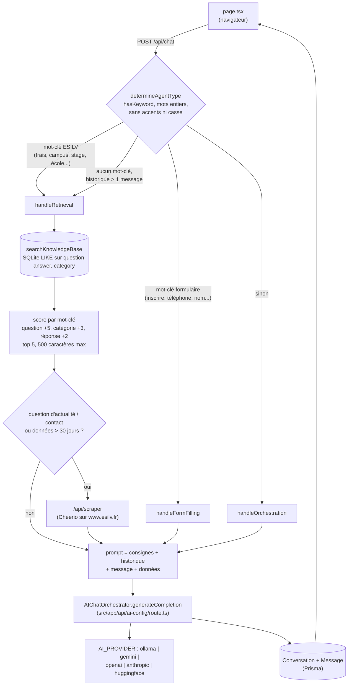
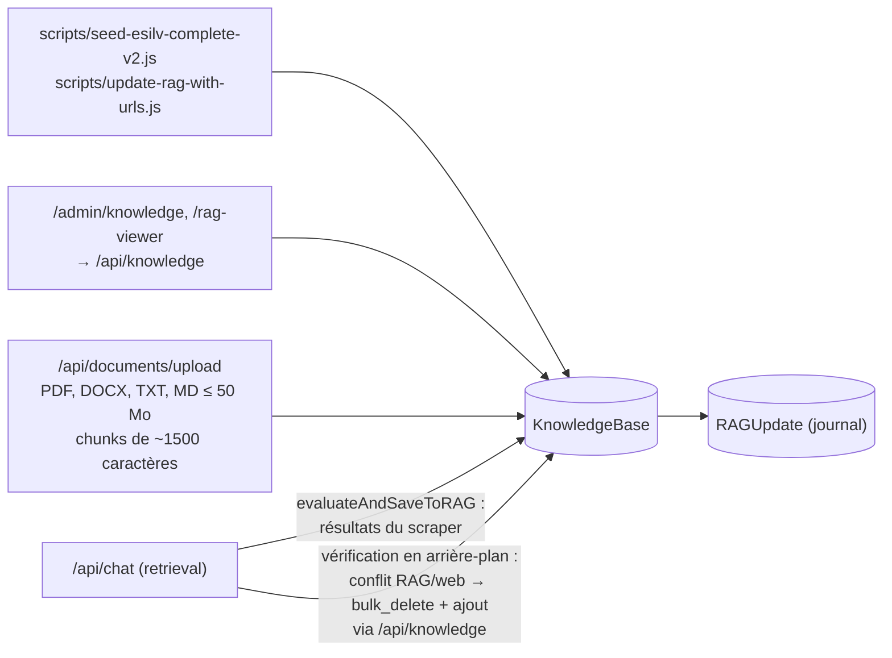

# Architecture

Ce document décrit ce que fait réellement le code (`src/app/api/chat/route.ts` en premier lieu). Ce n'est pas un système multi-agents : un seul orchestrateur choisit **par mots-clés** un des trois prompts LLM.

## Parcours d'une question

Points à connaître :

- **Routage** : `src/lib/keyword-match.ts`. Les mots-clés ESILV passent avant ceux du formulaire (« frais d'inscription » reste une question RAG). « nombre » ne déclenche pas « nom ». Le handler formulaire ne rend aucun formulaire : il demande les coordonnées dans la conversation.
- **RAG** : recherche par mots-clés (`extractKeywords` retire les mots vides, ajoute singulier/pluriel et version sans accents, 6 mots-clés max). Pas d'embeddings, pas de base vectorielle.
- **Scraper** : `src/app/api/scraper/route.ts`, URL de base fixe `https://www.esilv.fr`. Sur `main`, le chat l'appelle en HTTP sur `localhost:3000`. Avec #8, il l'appelle en interne, dans le même processus.
- **Confiance** : `calculateConfidence` combine nombre de sources, score moyen, âge des données et usage du scraper. C'est une heuristique, pas une probabilité.
- `/api/chat/stream` existe mais l'interface n'appelle que `/api/chat`.

## Qui écrit dans la base de connaissances

Le texte de toutes ces sources finit tel quel dans le prompt du LLM. Voir [SECURITY.md](../SECURITY.md).

## Données

`prisma/schema.prisma`, SQLite (`DATABASE_URL`) : `User`, `Conversation`, `Message`, `FormSubmission`, `Document`, `KnowledgeBase`, `RAGUpdate`.

## Limites connues

- Routage et RAG par mots-clés : pas de synonymes ni de lemmatisation au-delà du pluriel en s/x ; une question sans mot-clé de la liste part en orchestration.
- Une base vide renvoie le texte « Aucune information spécifique trouvée… », qui n'est pas vide : la branche « fallback (RAG vide) » vers le scraper ne s'exécute pas (test `it.fails` dans `src/app/api/chat/route.test.ts`).
- Les scripts de `scripts/` appellent `/api/knowledge` en HTTP sur `localhost:3000` sans cookie admin : ils reçoivent 401 une fois #8 mergée.
- SQLite fichier : une seule instance, pas de déploiement serverless multi-instances (voir `DEPLOYMENT.md`).
